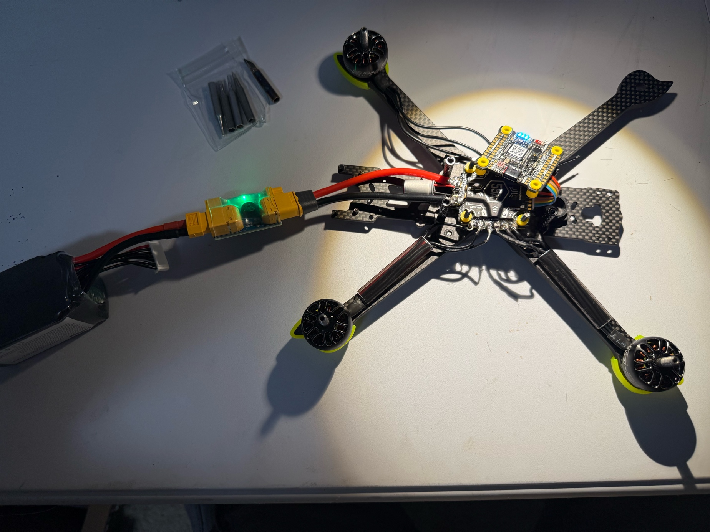
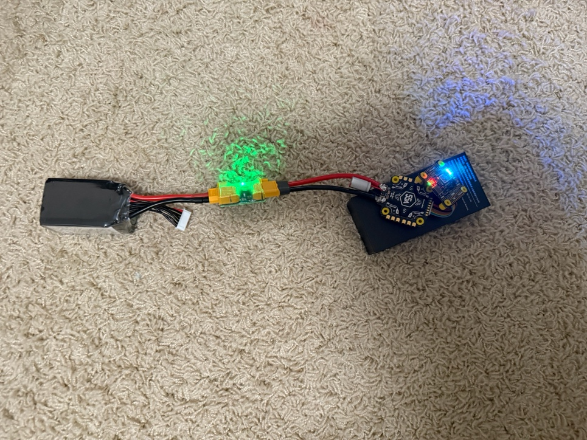
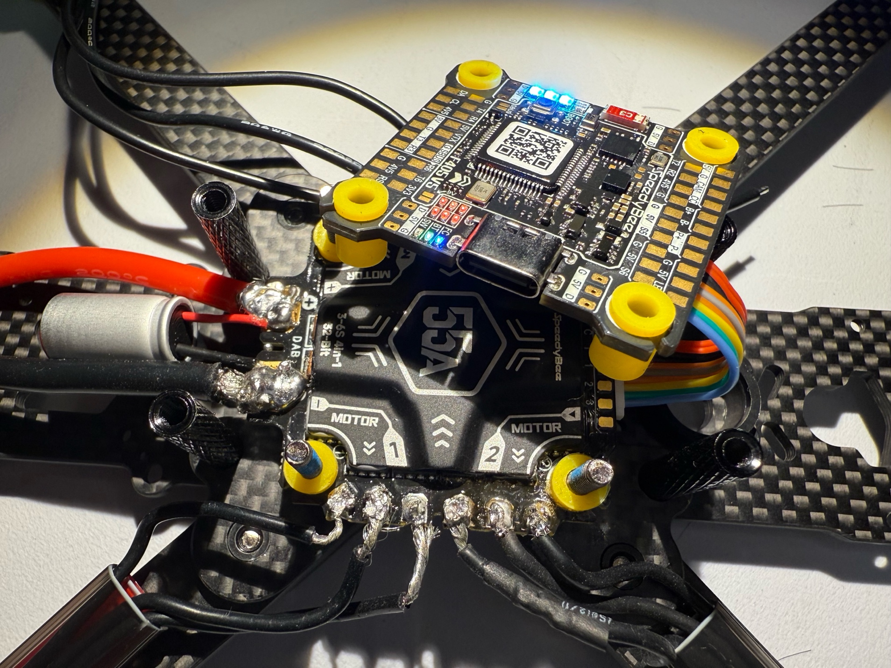

# Project Summary: Scratch-Built 5" FPV Quadcopter

**Status as of October 12, 2026:** fully wired and bench-tested; training in a flight simulator before the first real flight.

---

## What this project is

I'm designing, building, and learning to fly a 5-inch FPV quadcopter from
individual components rather than a ready-to-fly kit. The goal is to learn
the fundamentals of aerospace engineering hands-on: the physics of flight,
propulsion, control systems, and the electrical systems that tie them
together. Every part was chosen for a reason, every connection was made by
hand, and every step is logged in this repository.

I started in July 2026 with no soldering, electronics, or flight experience.

## Progress so far

**Learned the physics before buying anything** — [Week 1 log](logs/week-01-fundamentals.md)
Pitch, roll, and yaw; the four forces of flight; why drag grows with the
square of speed; why a quadcopter needs a thrust-to-weight ratio above 1.0
when an airplane flies at about 0.3; and why diagonally opposite motors spin
the same direction so their torques cancel.

**Designed the aircraft and chose every component** — [Week 2 log](logs/week-02-parts-and-frame.md)
Compared motor speeds, frame types, battery voltages, and ESC boards to stay
on budget while matching every part to every other part. When the planned
flight controller was discontinued mid-project, I found and switched to its
successor. Learned to solder on a practice board, then assembled the frame
and mounted the motors.

**Powered up the electronics and soldered the motors** — [Week 3 log](logs/week-03-power-and-motor-soldering.md)
Soldered the battery connector and capacitor to the speed controller, then
powered it up for the first time through a short-circuit protector.

The motors were the hardest part. For hours the solder balled up and rolled
off the pads. Researching the problem, I learned that this happens when the
pad isn't hot enough for the solder to bond: the large copper pads pull heat
away faster than my iron was supplying it. Raising the temperature from
650°F to 750°F and tinning the pads first fixed it. I also tested for short
circuits after each motor was connected, rather than after all four, so any
mistake would be caught at the joint that caused it.

**Finished the wiring and brought it to life** — [Week 4 log](logs/week-04-wiring-pairing-simulator.md)
With the Week 3 lesson applied, soldering went much faster: I resoldered all
four motors at the higher temperature, testing for shorts after each one,
then soldered the radio receiver to much smaller pads that needed more
precision. I paired the receiver to the RadioMaster transmitter over
ExpressLRS, set each motor's spin direction in the SpeedyBee app, and
confirmed all four motors spin under radio control with the props off.

**Training as a pilot before the first flight** — [Week 4 log](logs/week-04-wiring-pairing-simulator.md)
This aircraft produces several times its own weight in thrust, enough to
accelerate faster than a beginner can react. Instead of learning by crashing,
I'm practicing in FPV flight simulators with the same RadioMaster transmitter
that flies the real drone, so the stick skills carry over directly. Setting
it up meant mapping every control (pitch, roll, yaw, throttle, arm, disarm,
flight mode) to the right stick or switch, and learning the difference
between flight modes.

## The aircraft

| Component | Part | Role |
|---|---|---|
| Frame | iFlight Nazgul ECO XL5, 245 mm carbon fiber | Structure |
| Flight controller + ESC | SpeedyBee F405 V5, 55A 4-in-1 | Stabilization and motor control |
| Motors | 4× iFlight XING-E Pro 2207 1800KV | Propulsion |
| Propellers | Gemfan Hurricane 51466, tri-blade | Thrust |
| Battery | 6S LiPo, 1300 mAh (~25 V) | Power |
| Radio | RadioMaster Pocket → RP1 receiver, ExpressLRS 2.4 GHz | Control link |
| Video | Caddx Ratel 2 camera → AKK 5.8 GHz transmitter → goggles | First-person view |

## What's next

- [ ] Finish simulator training
- [ ] First flights: hover in self-leveling mode, open field, throttle limited
- [ ] Measure real hover throttle against the predicted value
- [ ] Record flight data and tune the control loops
- [ ] Experiment: how propeller pitch affects flight time and current draw

## Timeline

| Date | Milestone | Log |
|---|---|---|
| July 2026 | Flight fundamentals | [Week 1](logs/week-01-fundamentals.md) |
| Sep 14, 2026 | Parts selected and received; soldering practice; frame built, motors mounted | [Week 2](logs/week-02-parts-and-frame.md) |
| Sep 27, 2026 | Battery connector and capacitor soldered; first power-up; first motors soldered | [Week 3](logs/week-03-power-and-motor-soldering.md) |
| Oct 2026 | All motors resoldered; receiver wired; radio paired; motors verified spinning; simulator training | [Week 4](logs/week-04-wiring-pairing-simulator.md) |

_Updated as the project progresses. The original Word check-ins are kept in
the repository root, and the commit history records when each step happened._
