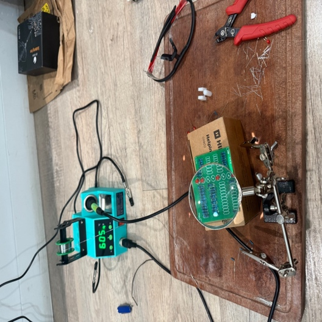
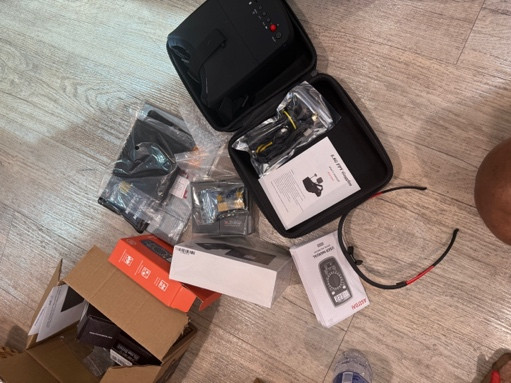
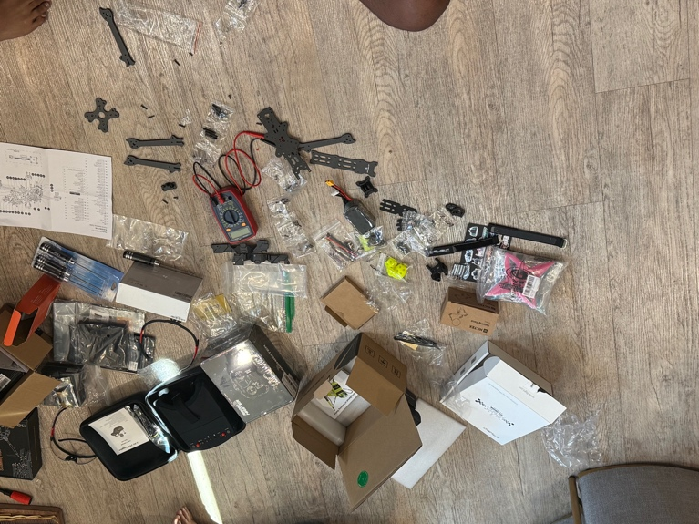
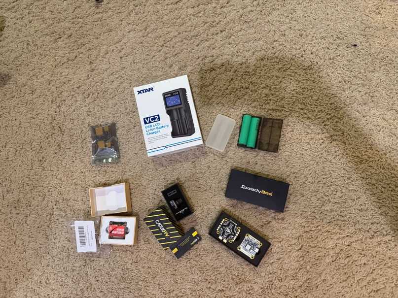

# Week 2 Check-In: Parts, Soldering Practice, and Frame

**Date:** September 14, 2026  
**Original:** [Week 2 Check In.docx](../Week%202%20Check%20In.docx) · [Project summary](../README.md)

---

Week 2 Check In:

Sep 14th 2026

1.  Researched all needed parts needed to build a quadcopter, from practice and general use to the specific parts themselves.

2.  Compared different motor speeds, frame types, battery voltages, ESC boards, etc. to build the quadcopter, while staying under budget and helping to learn in the process.

3.  All parts arrived several days later and started the building process.

4.  Begun with some preliminary basics like learning to solder with the practice kit, figuring out the purpose of each of the parts, and how they interact with each other in the finished build.

5.  Kicked off the building with the framework for the drone, attempting to see the general shape and getting the ball rolling on the build.

6.  Mounted the motors, while testing if they were effective, and learning about CC and CCW rotations and how they affect the balance and rotation of the drone.

7.  Started learning about the internal structure, including the ESC stack that goes in the central cavity, and all adjacent parts that help conduct inputs from the: Remote-ESC Stack-Motors-Propellors.

*Soldering practice kit with completed board*

*Parts including multimeter, goggles, and batteries*

*Parts laid out after unboxing, before assembling the frame*

*Second batch of parts: ESC stack, battery chargers*
