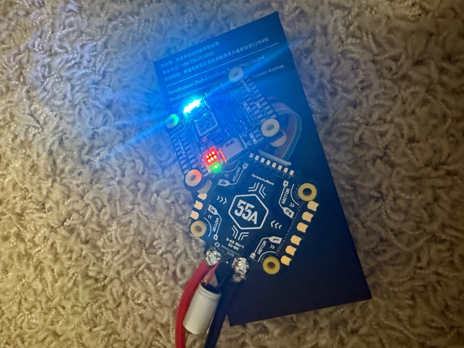
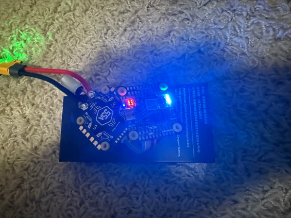

# Week 3 Check-In: Powering the Stack and Soldering the Motors

**Date:** September 27, 2026  
**Original:** [Week 3 Check in of the Drone Project Sep 27th.docx](../Week%203%20Check%20in%20of%20the%20Drone%20Project%20Sep%2027th.docx) · [Project summary](../README.md)

---

Week 3 Check in of the Drone Project Sep 27th, 2026

Done a bit of work last week with all the hardware. Here are some of the learnings so far

1.  There are two important circuit boards that makes up what quad copter: 1. The Flight Controller 2. The ESC Electronic Speed controller

2.  The ESC is the board that connects to power and all the motors connect to the ESC

3.  The ESC power needs to be soldered to the XT 60 connector, and the motors needs to be connected to it.

4.  The ESC and the Flight Controller can be connected using multi-pin ribbon cable.

5.  The first thing I tried was to solder the XT60 and the Condenser to the ESC. The condenser was easy to connect since it had a grove, and the condenser connectors were thin. I lined up the positive and negatives. The positive was a longer wire than the negative and was able to solder it in a few minutes.

6.  However, when we tried to connect XT 60, it was not working. The cable was too thick and the solder won’t stick. The temperature I had the soldering Iron was 650 degrees Fahrenheit and I was trying to heat up the pad. After a few unsuccessful attempts I was able to solder the XT 60 to the ESC. The soldering looked messy however the XT 60 cable stuck firmly to the ESC.

7.  Now I wanted to see If the power can be connected to the XT 60. I learned Before I connect the power to the ESC, I should connect a Smoke detector to the XT 60 and then connect the power to the Smoke detector. This is a precaution, so we don’t fry the board if there was any short circuit.

8.  We connected the ESC and the Flight Controller, the ESC is soldered to the XT 60 cable, which is in turn connected to the Smoke Detector and the Battery.

9.  Once I connected the battery, The entire circuit came alive with lights Flashing

*First power-up: battery through the smoke stopper (green = no short) into the ESC*

*Flight controller and ESC powered on*

*Stack powered through the soldered XT60 lead*

This was great to see. We proved that the ESC and Flight Controller are powered up and ready to go.

10. We also installed the SpeedyBee Flight Controller App, and it was able to recognize the Flight Controller. This I understand is where the FC and ESC will be configured.

11. Now all the is left is soldering the Motors to the ESC and the Radio Receiver to the Flight Controller. However, the soldering of the Motor to the ESC was a challenge.

12. I mounted the ESC and FC on to the Frame and connected one motor to the Frame and thought that this should be easy to solder the three wires on the motor to the pad.

13. First, I attempted to solder the wires straight to the Pads like we did with the XT 60. The solder never stuck to the pads. It seemed to not work at all. The soldering iron was at 650 degrees Fahrenheit; same temperature we used to solder the XT 60.

14. I researched the internet and watched some videos and found that the first thing to do is put some soldering on the pads of the ESC without trying to attach the motor wires. Once the soldering is there on the pads then attach the motor wires.

15. However, when I attempted to put solder on the pads the Solder won’t stick to the ESC pads. I kept at it for a few hours. I almost gave up. The soldering kept turning into balls and started rolling of the ESC pads. After taking a break and watching a few more YouTube videos, I learnt that this happens if the pad is not heating enough.

16. I was soldering with 650 degrees Fahrenheit the whole time, I tried turning up the temperature to 750 degrees. I tinned the pads and tried soldering and to my surprise this time the soldering stuck to the pads.

17. I added the soldering to the three pads for Motor 2 and now was able to attach the three wires to the pads.

18. One recommendation was to check for short circuits every time a motor is connected so we don’t go too far into the soldering with a short circuit.

19. So, I connected the Smoke Detector and the Batter to check to see if there are any issues. The lights came on green on the smoke detector and lights came on the flight controller like before.

20. I connected a second motor and repeated the steps of soldering them and testing them. The soldering of the second motor to the ESC and the test to see if there is any short circuit also passed. See picture below:

*Stack mounted in the frame with motors wired*

*Close-up of motor wires soldered to the ESC pads*

