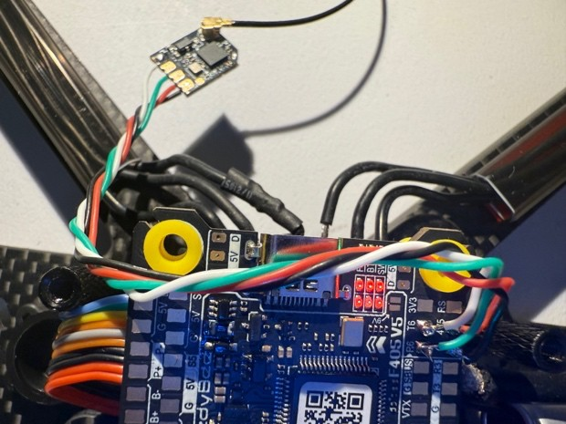
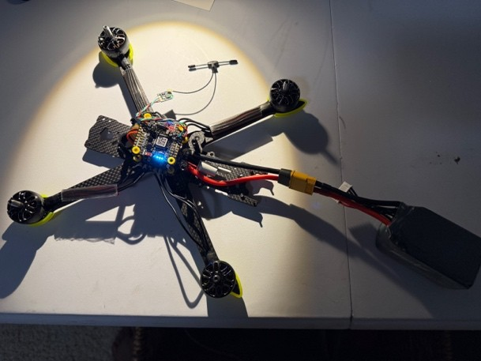
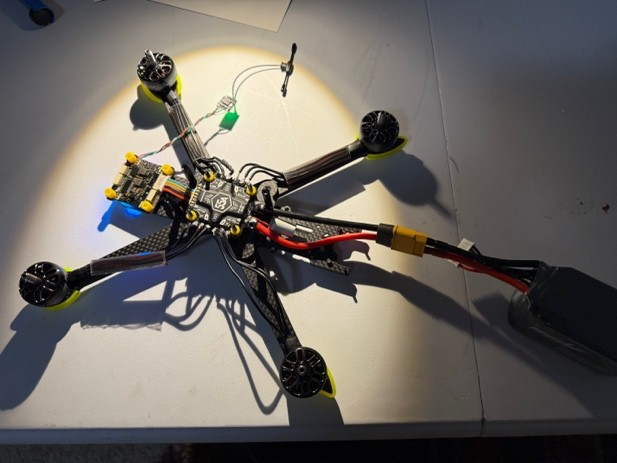

# Week 4 Check-In: Wiring, Radio Pairing, Motor Test, and Simulator Training

**Date:** October 2026  
**Original:** [Week 4 Check-in.pdf](../Week%204%20Check-in.pdf) · [Project summary](../README.md)

---

- Increased soldering heat from 650 to 750: cut down soldering time significantly and improved quality
- All motors resoldered with higher quality and tested with smoke stopper for short circuits
- Soldered receiver antenna using new heat knowledge; much smaller pads required more precision
- Paired RadioMaster to receiver through ExpressLRS WiFi connection
- Assigned joystick to motor spin (props off) to ensure everything was paired correctly
- Decided not to test drone after research; new fliers often crash; thus paired RadioMaster to online simulator and practicing there
- Assigned each control aspect (pitch, yaw, roll, motor speed, arm, disarm, flight mode) to proper controls after learning the difference between flight modes and spring loaded vs. regular joysticks
- Gaining proficiency with different flight modes and stably flying
- Configured rotation of motors in proper directions, while syncing to RadioMaster controller
- Learned about important safety features that inhibit motor testing while Bluetooth is connected

*Receiver wired to the flight controller*

*Fully wired, top view*

*Fully wired with the receiver mounted*

## Motor test video
Setting each motor's spin direction in the SpeedyBee app, props off.

https://github.com/user-attachments/assets/1cef1123-ae33-4eb0-9fb3-d06f2cf1a8d8

All four motors spinning under control of the RadioMaster joystick, props off.

https://github.com/user-attachments/assets/3ec13797-7e65-4c1a-946d-189287010383

